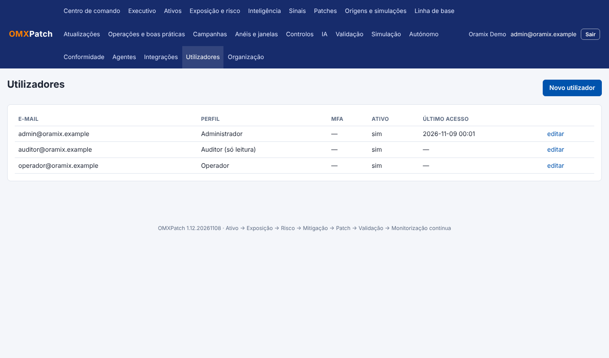
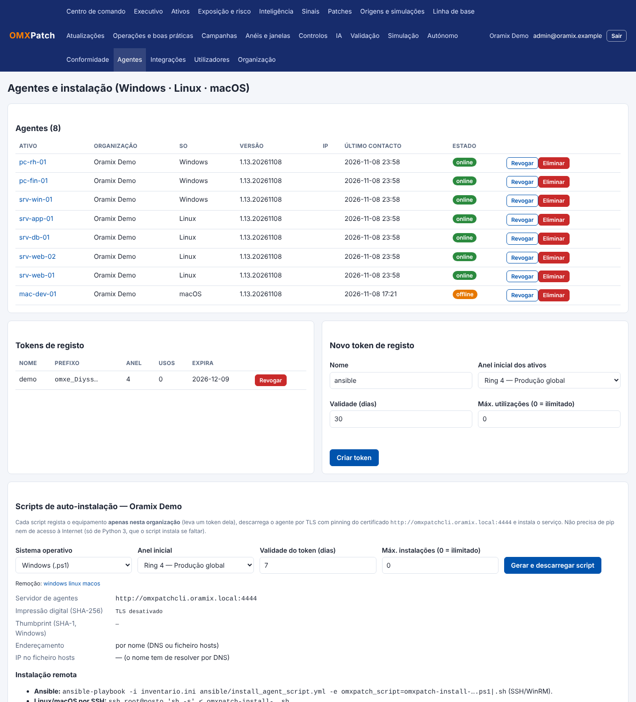
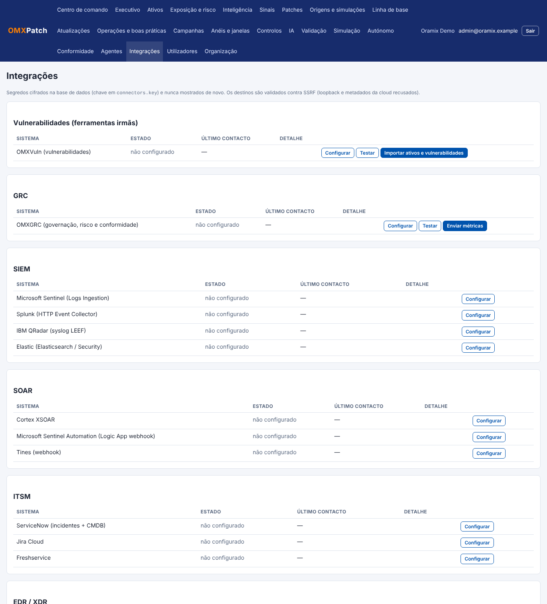
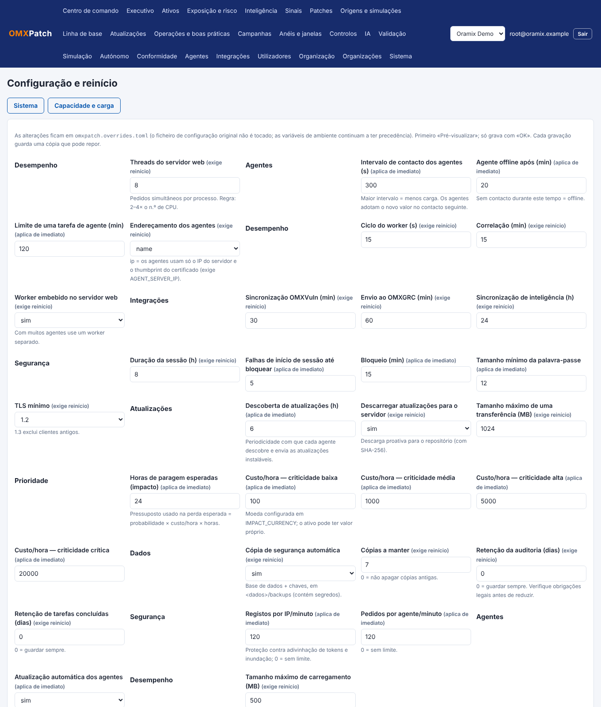
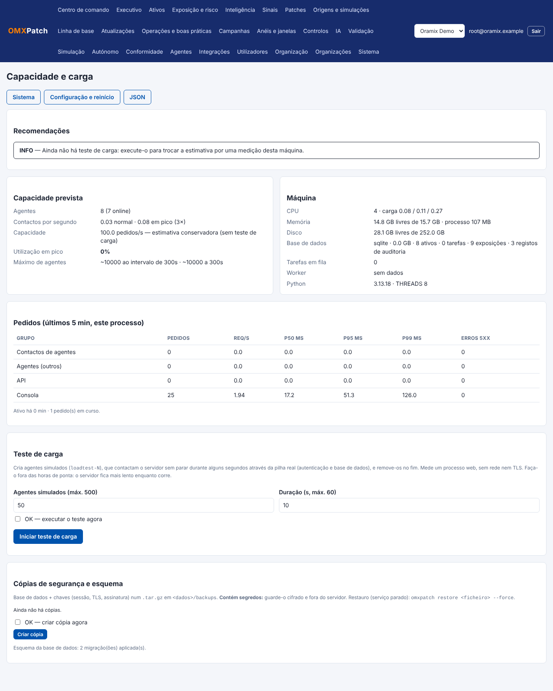

# 1. Visão geral e arquitetura

O OMXPatch é composto por um **centro de comando** (servidor web Flask/Python com *worker*) e por **agentes** leves instalados nos ativos. É a ferramenta irmã do OMXVuln, OMXGRC e OMXAware e usa a mesma base tecnológica e modo de trabalho.

```
  Navegador ──TLS 4434──►┌────────────────────────────┐◄──TLS 4444── Agentes (Windows/Linux/macOS)
  (utilizadores, API)    │  Centro de comando          │   (pull: puxam tarefas, certificado fixado)
                         │  · consola de gestão        │
                         │  · API de agentes           │◄── OMXVuln (ativos e vulnerabilidades)
                         │  · worker (correlação,      │──► OMXGRC (métricas, evidências)
                         │    campanhas, descargas,    │──► SIEM / ITSM / EDR / Cloud
                         │    simulações, cópias)      │
                         └────────────┬───────────────┘
                                      │ base de dados (SQLite por omissão, PostgreSQL)
                                      │ repositório de patches · certificados · cópias
```

**Princípios de desenho**

- **Agente leve, inteligência no servidor.** O agente só recolhe telemetria de leitura (inventário, atualizações instaláveis e o contexto do ativo) e executa as ordens aprovadas. A correlação, a simulação de exposição e a priorização correm no servidor.
- **Modelo *pull*.** Os agentes só fazem ligações de saída para a porta 4444; não há portas abertas nos ativos.
- **Nada muda sem OK.** Todas as alterações passam por simulação e aprovação explícita (e, opcionalmente, por uma *change* no ITSM).
- **Multi-organização.** Cada agente reporta a uma única organização; os dados são isolados por organização.
- **Sem dependências no agente.** O agente só usa a biblioteca padrão do Python (3.8 a 3.13 testados) e não depende do Ansible.

**Portas**

| Porta | Sentido | Utilização | Certificado |
|---|---|---|---|
| **4434/tcp** | utilizadores → centro | Consola de gestão e API REST (`/api/v1`) | `omxpatch.oramix.local` (autoassinado, 2 anos) |
| **4444/tcp** | agentes → centro | API de agentes (`/agent/v1`) | `omxpatchcli.oramix.local` (autoassinado, 2 anos) |

Cada porta só serve o seu perfil: a 4434 não responde a `/agent/…` e a 4444 só responde a `/agent/…` e `/healthz`.

# 2. Requisitos

| Componente | Requisito |
|---|---|
| Servidor | Ubuntu Server 24.04/26.04 (ou Debian), **ou** Windows Server 2019/2022/2025, Windows 10/11, **ou** Windows Server 2012 R2 (pacote próprio) |
| Python | 3.9 ou superior (instalado pelo instalador se faltar) |
| CPU/RAM | 2 vCPU / 4 GB para dezenas de agentes; veja o dimensionamento no capítulo 12 |
| Disco | O repositório de patches e a base de dados crescem: reserve ≥ 20 GB |
| Rede | 4434 e 4444 acessíveis; o servidor acede à Internet (ou ao seu espelho) para inteligência e descarga de atualizações |
| Agentes | Windows 7+/Server 2012 R2+, Linux (apt/dnf/yum/zypper), macOS; Python 3.8+ (o script de instalação instala-o se faltar) |

# 3. Instalação do centro de comando

Descarregue os pacotes em *Releases* do repositório GitHub e **verifique o `SHA256SUMS`**.

## 3.1 Ubuntu / Debian

```bash
tar xzf omxpatch-ubuntu-<versão>.tar.gz && cd omxpatch-ubuntu-<versão>
sudo ./install.sh --hostname omxpatch.empresa.pt --agent-hostname omxpatchcli.empresa.pt --server-ip 10.0.0.5
```

O instalador: instala Python/venv/pip (via apt, ou dos `.deb` incluídos se não houver rede), cria o utilizador `omxpatch`, instala a aplicação em `/opt/omxpatch`, a configuração em `/etc/omxpatch/omxpatch.toml` e os dados em `/var/lib/omxpatch`, gera os **dois certificados**, cria os serviços systemd **`omxpatch`** (web) e **`omxpatch-worker`** (ambos com `Restart=always`), abre 4434/4444 no `ufw` e mostra a **palavra-passe inicial**.

Opções: `--with-ansible` (modo sem agente), `--no-firewall`, `--port`, `--agent-port`, `--no-apt`, `--no-service`. Para atualizar, extraia a nova versão e execute `./install.sh` outra vez (dados e configuração mantidos). Remover: `sudo /opt/omxpatch/uninstall.sh [--purge]`. Registo: `/var/log/omxpatch-install.log`.

## 3.2 Windows Server / Windows 10/11

Extraia `omxpatch-windows-<versão>.zip` e execute `Instalar.cmd` (pede elevação) ou, numa PowerShell de administrador:

```powershell
.\Install-OMXPatch.ps1 -Hostname omxpatch.empresa.pt -AgentHostname omxpatchcli.empresa.pt -ServerIp 10.0.0.5
```

Instala o Python se faltar (do `python-installer.exe` do pacote ou de python.org), a aplicação em `C:\OMXPatch`, a configuração e os dados em `C:\ProgramData\OMXPatch`, duas **tarefas agendadas SYSTEM** (`OMXPatch` e `OMXPatch-Worker`, com ciclo de reinício), regras de firewall para 4434/4444 e mostra a palavra-passe inicial. Registo: `%TEMP%\omxpatch-install.log`.

## 3.3 Windows Server 2012 R2

Use o pacote **`omxpatch-windows2012r2-<versão>.zip`**: instala o Python 3.11 (o 3.12 já não suporta o 2012 R2), faz verificações prévias (Windows de 64 bits, PowerShell 4+, .NET 4.5+, atualização **KB2999226**), ativa TLS 1.2 no .NET e usa dependências compatíveis. Se faltar a KB2999226 coloque o `.msu` em `prereq\`. O 2012 R2 está fora do suporte da Microsoft: isole-o e valide primeiro num laboratório.

## 3.4 Primeiro acesso

1. Aceda a `https://<hostname>:4434/`. O navegador avisa do certificado autoassinado — confirme a impressão digital (`omxpatch tls info`).
2. Entre com o super-administrador mostrado no fim da instalação (também em `omxpatch initial-password`) e **altere a palavra-passe**.
3. Em **Tenants** crie o tenant (organização) do cliente. Em **Utilizadores** crie os administradores e operadores. Em **Agentes** gere os scripts de instalação.

Se perder o acesso: `omxpatch reset-admin --email <e-mail> [--reset-mfa]`.

# 4. Tenants, utilizadores e acesso



- **Tenants** (super-administrador): nome, país, tipo de entidade NIS2, responsável de segurança, **licença** (data de expiração) e utilizadores. Licença: válida até ao fim do dia de expiração; nos últimos 30 dias há aviso; segue-se um **período de tolerância** (15 dias) e depois a organização fica **suspensa** (as ferramentas deixam de aceitar agentes). Configurável em `LICENSE_WARN_DAYS`/`LICENSE_GRACE_DAYS`.
- **Organização** (administrador): SLA por categoria de risco (1/7/30/90/180 dias por omissão), e-mails de notificação, *webhook*, **exigir MFA**, modo autónomo e **identidade visual** (logótipo e cores por organização).
- **Utilizadores:** perfis *Administrador*, *Operador* e *Auditor*. Em cada utilizador pode desativar, repor a palavra-passe e o MFA. O super-administrador inicial (`admin@omxpatch.local`) é protegido.
- **MFA (TOTP)** com códigos de recuperação; quando a organização o exige, é obrigatório na primeira sessão.
- **Tokens de API** por utilizador (validade configurável), com o perfil e a organização do utilizador.
- **Auditoria:** *Organização → Auditoria* (administrador e auditor) regista inícios de sessão, alterações, aprovações, execuções, importações, cópias, reinícios… com utilizador e IP; pode ser enviada por **syslog** para o SIEM.

**Segurança de acesso:** CSRF em todos os formulários, cookies *HttpOnly/SameSite/Secure*, política CSP sem *scripts* nem estilos inline, bloqueio após falhas (5 por omissão, 15 min), palavra-passe mínima de 12 caracteres, sessão de 8 h.

# 5. Agentes



## 5.1 Instalação automática

Em **Agentes** escolha o sistema operativo (Windows, Linux, macOS), o anel inicial e a validade do token, e descarregue o **script de auto-instalação** — contém um **token de registo** da organização: trate-o como credencial. O script instala o Python se faltar, descarrega o agente por TLS **com a impressão digital do certificado fixada**, verifica o SHA-256 do pacote, regista o equipamento **apenas nessa organização** e instala o serviço (systemd, tarefa agendada SYSTEM ou LaunchDaemon). Um equipamento já registado noutra organização é recusado.

Também pode gerar **tokens de registo** (com limite de utilizações e validade), revogar tokens, revogar ou eliminar agentes (liberta o equipamento para outra organização) e ver versão, último contacto e estado online/offline.

## 5.2 Confiança: impressão digital, só por IP e rotação

Os agentes **não precisam de DNS, ficheiro hosts nem CA**: confiam na **impressão digital** (SHA-256, ou o *thumbprint* SHA-1 do Windows) do certificado da porta 4444, mostrada na página *Agentes*.

- **Endereçamento só por IP:** defina `AGENT_ADDRESS_MODE=ip` e `AGENT_SERVER_IP=<IP>`. Os scripts passam a usar `https://<IP>:4444` e não alteram o ficheiro hosts. Por IP sem impressão digital o agente **recusa** ligar. `AGENT_SERVER_URLS` publica endereços alternativos (*failover*) aos agentes.
- **O certificado dos agentes não é regenerado** quando o IP do servidor muda (para o thumbprint se manter).
- **Rotação sem corte:** quando faltam menos de 60 dias para expirar, o worker prepara o certificado seguinte e a consola publica os **dois** thumbprints; os agentes só os adotam se contiverem o que acabaram de validar. Passados 7 dias, o novo substitui o atual no arranque seguinte. Um agente offline durante todo o período tem de ser reinstalado.

## 5.3 Segurança do protocolo

- **Tarefas assinadas (Ed25519):** cada tarefa leva `iat` e assinatura ligadas ao agente. O agente — que verifica em Python puro, sem dependências — **recusa** tarefas alteradas, de outro agente, sem assinatura ou com mais de 1 h. A chave pública é fixada no registo e só se substitui por uma lista que contenha uma já conhecida. Gestão: `omxpatch signing show|rotate`. A chave privada está em `<dados>/signing/task.key`. (Protege contra alterações na base de dados ou num proxy; não contra quem controle o servidor inteiro.)
- **Atualização automática do agente** (`AGENT_AUTO_UPDATE`, ligada): o agente só atualiza com o pacote **assinado** pela consola, confere SHA-256 e assinatura, corre o `selftest` do código novo e só então troca a pasta (a anterior fica em `omxpatch_agent.prev`, com reversão) e reinicia-se. Nunca atualiza instalações em `site-packages` ou sem assinatura.
- **Limitação de pedidos:** registo/pacote por IP (`RATE_ENROLL_PER_MIN`), bloqueio de 30 s após `RATE_AUTH_FAIL_PER_MIN` tokens/chaves inválidos por IP e `RATE_AGENT_PER_MIN` por agente.
- **Chaves de agente** guardadas só como *hash* no servidor; revogáveis.

## 5.4 Python do sistema e funcionamento sem Ansible

O agente faz tudo sozinho em Python e usa o que o sistema tiver: **3.8 a 3.13 testados**, 3.7 apenas por análise estática. Os scripts de instalação escolhem o Python conforme o SO (Windows anterior ao 10 / Server 2012 R2: 3.8.10). O comando **`python -m omxpatch_agent selftest`** valida cada capacidade no equipamento e o interpretador (versão, OpenSSL, nível `ok`/`legacy`) é reportado à consola. O **Ansible** é opcional e serve o modo **sem agente** (ativos com ligação SSH/WinRM).

## 5.5 O que o agente recolhe

| Informação | Frequência | Notas |
|---|---|---|
| Inventário (software, portas, SO, KB instalados, reinício pendente, servidores web, capacidades) | no registo e a cada 24 h | |
| **Contexto do ativo** (processos, escutas e âmbito, serviços, firewall, administradores, SSH/RDP/SMB/UAC, SELinux/Defender) | com o inventário | Só leitura; prioridade baixa; ~25 ms em Linux |
| **Atualizações instaláveis** | a cada 6 h e a pedido | Só leitura; reenvio garantido até a consola confirmar |
| Execução de tarefas aprovadas | quando existem | patches, boas práticas, controlos, validação, simulações |

**Faz:** só ligações de saída, TLS, ordens assinadas e aprovadas. **Não faz:** não abre portas, não executa nada sem tarefa assinada, não envia conteúdo de ficheiros, palavras-passe nem chaves.

# 6. Integrações



Em **Integrações** (administrador) configure cada ligação por organização: URL, utilizador, segredos (cifrados), opções, verificação de TLS e ativação; use **Testar** e **Sincronizar**. Os destinos são validados contra SSRF (loopback e *link-local* bloqueados).

## 6.1 OMXVuln (origem de ativos e vulnerabilidades)

Configure o URL e o token de API (com `tenant_id` apenas para super-administradores). **Integrações → OMXVuln → Importar ativos e vulnerabilidades** importa:

- **ativos** (`/api/v1/assets`, ou `/targets`; opção `assets_path`): nome, IP, FQDN, SO, criticidade, etiquetas, responsável, software. Ativos já geridos por agente só são **completados**, nunca sobrescritos;
- **vulnerabilidades** (`/api/v1/findings`): CVE, componente, versão instalada e corrigida, KEV/EPSS (opção `min_severity`).

**Simule primeiro:** mostra o que seria criado e atualizado sem gravar nada; só importa com «OK». O worker repete a importação de `OMXVULN_SYNC_MINUTES` em `OMXVULN_SYNC_MINUTES` (ativos incluídos, salvo `sync_assets=false`). Após validar uma remediação, o estado volta ao OMXVuln (remediada) e é pedido novo *scan*. *Nota:* o mapeamento de campos foi feito sem acesso ao código do OMXVuln; valide com a simulação numa instância real.

## 6.2 OMXGRC

O OMXPatch **envia** métricas dos cinco referenciais e uma evidência por remediação validada; o OMXGRC pode **consultar** `GET /api/v1/grc/controls` e `/api/v1/grc/evidence`. Os caminhos são configuráveis (`evidence_path`, `metrics_path`).

## 6.3 SIEM, EDR, cloud, firewalls e descoberta

Catálogo completo na *Referência* (`REFERENCIA.md`, secção Integrações): Microsoft Sentinel, Splunk, QRadar (syslog), Elastic; Defender XDR, CrowdStrike, SentinelOne; Tenable, Qualys, Rapid7, Wiz, Prisma; Check Point, Palo Alto, Fortinet, Zscaler; Entra ID, VMware, Azure, GCP, Kubernetes; ServiceNow, Jira, Freshservice. Os sinais também entram por **webhook/ficheiro** (`/api/v1/signals`). Os conectores de terceiros foram escritos segundo a documentação pública e testados com respostas simuladas, **não** contra instâncias reais: valide-os no seu ambiente.

## 6.4 ITSM e governação de mudanças (desativada por omissão)

Por omissão, **todo o ciclo de aprovação é feito diretamente pela solução** (simular → OK → executar). Para exigir uma **change** no ITSM:

1. Configure a integração **ServiceNow**, **Jira** ou **Freshservice**.
2. Ponha a opção **`change_management` = `true`** (a predefinição é `false`).
3. A partir daí, cada **plano** (e cada **controlo**) passa a ter *Pedir change no ITSM*: a solução cria a change com as ações simuladas, a **execução fica bloqueada** até o ITSM aprovar (ServiceNow: `approval = approved` e estado *Scheduled/Implement*, configurável em `approved_states`; Jira: `approved_statuses`/`rejected_statuses`; Freshservice: `approved_status_ids`) e, no fim, o resultado é escrito na change. O OK na solução continua a ser exigido.
4. **Fail-closed:** uma falha de comunicação ou uma rejeição **nunca** aprovam; uma change rejeitada é final.

Estados e campos testados só com respostas simuladas: valide numa instância de teste antes de ativar.

# 7. Configuração

## 7.1 Ficheiros e precedência

Ordem de precedência (maior para menor): **variável de ambiente** `OMXPATCH_<NOME>` › **`omxpatch.overrides.toml`** (alterações feitas na consola, em `<dados>`) › **`omxpatch.toml`** (`/etc/omxpatch/` ou `C:\ProgramData\OMXPatch\`) › omissão. A lista completa de parâmetros está em `REFERENCIA.md`.

Exemplo mínimo de `omxpatch.toml`:

```toml
data_dir = "/var/lib/omxpatch"

[server]
tls_enabled = true
tls_hostname = "omxpatch.empresa.pt"
port = 4434
session_cookie_secure = true
embedded_worker = false

[agents]
tls_hostname = "omxpatchcli.empresa.pt"
port = 4444
server_ip = "10.0.0.5"
address_mode = "ip"          # os agentes usam só o IP + impressão digital

[database]
url = "postgresql+psycopg://omxpatch:***@db/omxpatch"
```

## 7.2 Alterar a configuração pela consola



*Sistema → Configuração e reinício* (super-administrador) altera os parâmetros operacionais em **dois passos**: *Pré-visualizar* (mostra as diferenças e o que exige reinício) e, com a caixa **OK**, *Gravar*. Há validação cruzada (nunca grava uma combinação que não arranca), cópia de segurança de cada gravação e **Repor versão anterior**. As alterações ficam em `omxpatch.overrides.toml`; um ficheiro inválido é ignorado no arranque. Cada parâmetro indica se se aplica **de imediato** ou **após reiniciar**.

## 7.3 Reiniciar o serviço

O botão **Reiniciar** valida primeiro que a configuração arrancaria e recusa se não. Com supervisor (systemd; ciclo dos serviços Windows do instalador) o processo termina e é arrancado de novo; sem supervisor relança-se a si próprio. O worker separado termina no ciclo seguinte. Os agentes voltam a ligar-se sozinhos.

## 7.4 Parâmetros que mais vai usar

| Parâmetro | Para quê |
|---|---|
| `AGENT_HEARTBEAT_SECONDS` | Intervalo de contacto dos agentes (mais alto = menos carga). |
| `AGENT_OFFLINE_MINUTES` | Quando um agente passa a offline (≥ 2× o intervalo). |
| `AGENT_ADDRESS_MODE`, `AGENT_SERVER_IP`, `AGENT_SERVER_URLS` | Endereçamento dos agentes por IP + impressão digital e *failover*. |
| `UPDATES_SCAN_HOURS`, `UPDATES_AUTO_DOWNLOAD`, `UPDATES_MAX_DOWNLOAD_MB` | Descoberta e descarga proativa de atualizações. |
| `IMPACT_COST_*`, `IMPACT_OUTAGE_HOURS`, `IMPACT_CURRENCY` | Pressupostos da perda esperada. |
| `THREADS`, `EMBEDDED_WORKER` | Desempenho (capítulo 12). |
| `BACKUP_*`, `AUDIT_RETENTION_DAYS`, `TASK_RETENTION_DAYS` | Cópias e retenção. |
| `RATE_*` | Limitação de pedidos. |
| `TLS_MIN_VERSION` | `1.2` (omissão) ou `1.3`. |
| `DATABASE_URL` | Base de dados (SQLite por omissão; PostgreSQL recomendado em escala). |

# 8. Ativos, anéis, janelas e campanhas (administração)

Defina o **anel** de cada ativo (0 laboratório … 4 produção global), os **critérios de promoção** (sucesso ≥ 95 %, crashes ≤ 1 %, experiência ≥ 80, ≥ 1 equipamento, 24 h de observação — por omissão, em `RING_*`) e as **janelas de manutenção**. As campanhas distribuem um patch aprovado por anéis e só avançam se o anel anterior cumprir os critérios. Para ativos sem agente (Ansible): defina `ansible_user`, porta e `connection = ansible` e use o inventário gerado; os *playbooks* (19 ficheiros `.yml`) estão na pasta `ansible/`.

# 9. Descoberta de atualizações e repositório de patches

O agente envia a descoberta (apt, dnf/yum, zypper, Windows Update/WSUS, winget, Chocolatey, softwareupdate, brew); o servidor guarda-a, associa-a às exposições e **descarrega proativamente** os ficheiros com URL e SHA-256 anunciado para `<dados>/packages/<organização>/`.

**Política de descarga (segura por desenho):**

- Só descarrega com **SHA-256 anunciado** pela origem (`UPDATES_ALLOW_UNHASHED=false`); o hash é verificado **antes** de gravar — um ficheiro adulterado é rejeitado e nada fica no disco.
- Os endereços vêm de agentes (dados não confiáveis): cada ligação e **cada redirecionamento** é validado contra SSRF; há limite de tamanho (`UPDATES_MAX_DOWNLOAD_MB`, 1024 por omissão) e verificação de espaço em disco.
- `http` só é aceite com SHA-256 (os repositórios apt usam `http`; o hash do índice assinado garante a integridade).
- Falhas repetem com espera crescente (máximo 3 tentativas).

**Limites:** só apt (`.deb`) e winget (MSI/EXE do manifesto) têm descarga fiável; Windows Update só se o WUA expuser o URL; dnf/zypper/macOS não trazem hash verificável e usam o gestor do SO. O `apt-get install ./ficheiro.deb` resolve dependências nos repositórios do SO: **não** é um espelho offline completo.

# 10. Linha de base e boas práticas

As **boas práticas** (TLS 1.2/1.3, HSTS, versão, cabeçalhos em nginx/Apache/IIS; SSH; SMBv1/NLA) aplicam-se sempre por plano com simulação e OK, cópia de segurança, teste, verificação e reversão automática. A **linha de base** regista as remediações bem-sucedidas e exporta para as pipelines de imagens (Ansible, shell, Packer, JSON). Veja o *Manual de Utilização*.

# 11. Isolamento de ativos

O isolamento (controlo `isolate_host`) exige **aprovação** e um agente instalado. O agente mantém só a consola acessível (nftables/iptables, Windows Firewall com política *Block*, pf), testa a consola depois de isolar e **desfaz sozinho** se a perder, tem validade (padrão 2 h, máximo 24 h) e repõe o estado anterior. Mantenha sempre um **plano B** (acesso à consola do hipervisor) ao testar. Com a gestão de changes ativa, o controlo exige a change aprovada.

# 12. Capacidade, desempenho e escalabilidade



*Sistema → Capacidade e carga* (super-administrador; também `omxpatch capacity`) mostra a máquina (CPU, memória, disco, base de dados), os agentes online, a fila de tarefas e a latência por grupo de rotas, estima a capacidade e dá **recomendações**.

- **Modelo:** contactos/s previstos (agentes ÷ intervalo, ×3 em pico) contra a capacidade medida (com 40 % de folga) ou, sem teste, uma estimativa conservadora. Indica o máximo de agentes ao intervalo atual.
- **Teste de carga** (com «OK»): cria agentes simulados `loadtest-N` que contactam a pilha real (autenticação + base de dados) e remove-os no fim. Mede **um processo web, sem rede nem TLS**: é um limite superior; confirme com um piloto real. Numa medição de referência: ~174 pedidos/s com 30 agentes em SQLite.
- **Escalar:** aumente `AGENT_HEARTBEAT_SECONDS`; passe a **PostgreSQL** acima de ~300 agentes ou quando a auditoria crescer; execute o *worker* como serviço separado (`EMBEDDED_WORKER=false`) com muitos agentes; ajuste `THREADS` (2–4× o n.º de CPU).

# 13. Cópias de segurança, restauro, retenção e atualização

- **Cópia:** `omxpatch backup [list]` e **cópia diária automática** (`BACKUP_ENABLED`, `BACKUP_HOURS`, `BACKUP_KEEP`). Inclui a base de dados (SQLite pela API de *backup* online; PostgreSQL com `pg_dump` se existir) e os ficheiros que não se recriam (chave de sessão, certificados e chaves TLS, chave de assinatura, alterações de configuração) num `.tar.gz` com permissões 600 em `<dados>/backups`. **Contém segredos (chaves privadas):** guarde-o cifrado e fora do servidor. A página *Capacidade e carga* mostra as cópias e deixa criar uma.
- **Restauro** (serviço parado): `omxpatch restore <ficheiro> --force`. A base atual fica guardada como `*.before-restore-…`. O restauro recusa nomes fora do diretório de dados.
- **Retenção:** `AUDIT_RETENTION_DAYS` e `TASK_RETENTION_DAYS` (0 = guardar sempre) apagam auditoria e tarefas concluídas antigas. Verifique obrigações legais antes de reduzir.
- **Migrações versionadas:** `omxpatch db status|upgrade`. Cada migração corre uma vez, em transação (inclui DDL em SQLite), com cópia prévia da base; se uma falhar é revertida e o arranque pára. Não há reversão automática de migrações.
- **Atualizar a versão:** faça uma cópia, extraia o novo pacote e volte a executar o instalador (dados e configuração mantidos; as migrações correm no arranque).

# 14. Segurança

| Tema | Como está tratado |
|---|---|
| Transporte | TLS ≥ 1.2 (1.3 opcional) nas duas portas; certificados autoassinados geridos ou próprios (`TLS_CERT`/`TLS_KEY`); agentes com impressão digital fixada |
| Autenticação | Palavra-passe forte, MFA TOTP, bloqueio por falhas, tokens de API, sessão limitada |
| Autorização | Perfis administrador/operador/auditor/super-administrador; isolamento por organização |
| Integridade | Tarefas e pacote do agente **assinados**; patches com SHA-256; descargas verificadas |
| Aplicação | CSRF, CSP sem inline, cabeçalhos de segurança, SSRF validado nas integrações e descargas, limite de pedidos |
| Dados | Segredos das integrações cifrados (Fernet); chaves de agente só como *hash*; cópias com 600 |
| Auditoria | Registo de ações com utilizador e IP; envio por syslog |
| Alterações | Simulação + OK; reversão automática; ITSM opcional |

**Recomendações:** `session_cookie_secure = true`; certificados da organização no lugar dos autoassinados se tiver CA; PostgreSQL com TLS; acesso à 4434 só às redes de administração; cópias cifradas fora do servidor; rever `RATE_*`; ativar **MFA obrigatório** na organização.

**Pontos conhecidos a ter em conta:** a limitação de pedidos é em memória, por processo; a chave de assinatura não protege contra quem controle o servidor inteiro; os conectores de terceiros e o ITSM foram testados com respostas simuladas.

# 15. Operação e resolução de problemas

Reinstalar um agente reutiliza a mesma entrada (chave nova, histórico mantido). As entradas revogadas antigas eliminam-se uma a uma ou todas de uma vez com **Eliminar revogados**.

## Operação remota e registos dos agentes
Em **Agentes → Detalhe** (um agente) o administrador pode, a partir da consola:
- **Ativar/desativar a depuração completa** (validade em minutos; desliga-se sozinha). Em depuração o agente regista também os pedidos à consola, os comandos executados e os tempos de cada contacto, e envia-os como registos de «depuração».
- **Reiniciar** o agente e **atualizá-lo** para a versão publicada pela consola (pacote assinado, autoteste e reversão automática).
- **Pedir o envio imediato dos registos**; consultar, filtrar (tipo, nível, texto) e **exportar (CSV)** os registos de *operação*, *auditoria* e *depuração*. As ações feitas na consola ficam registadas com o utilizador que as pediu. Segredos (chaves, tokens, palavras-passe) são removidos antes de saírem do equipamento.

Os comandos são tarefas assinadas que o agente recolhe no **contacto seguinte**: o agente contacta a consola de **5 em 5 minutos** (`AGENT_HEARTBEAT_SECONDS`). A depuração é declarativa: mantém-se mesmo se o agente reiniciar, até expirar.

**Sem consola, o agente desliga-se.** Se não conseguir falar com a consola durante **2 horas** (`AGENT_GIVEUP_MINUTES`; 0 = nunca) o agente regista o facto, desativa o serviço e termina, poupando recursos (entretanto tenta com intervalos crescentes de 1, 2 e 5 min). Os eventos ficam guardados localmente (limite de 2 MB) e seguem quando houver contacto. Para o reativar depois de resolver a ligação: `sudo systemctl enable --now omxpatch-agent` (Linux), `sudo launchctl load -w /Library/LaunchDaemons/pt.oramix.omxpatch.agent.plist` (macOS) ou, em PowerShell administrador, `schtasks /Change /TN OMXPatchAgent /ENABLE` e `schtasks /Run /TN OMXPatchAgent` (Windows). O agente mostra-se como *offline* na consola até voltar.

**Todos os parâmetros são configuráveis em Sistema → Configuração (grupo Agentes):** intervalo de contacto, tempo até desligar, validade por defeito da depuração, envio de registos (ligar/desligar), nível mínimo dos registos de operação, eventos por envio e retenção dos registos (dias). Aplicam-se de imediato; os agentes adotam-nos no contacto seguinte.


**A lista de «Atualizações disponíveis» está vazia.** Abra **Atualizações → Diagnóstico por agente**: cada agente mostra o veredicto (agente anterior à 1.10 sem descoberta, sem contacto, sem descoberta recebida, origem com erro, ou sem atualizações pendentes). No próprio equipamento corra `omxpatch-agent updates` (mostra o resultado por origem: apt, dnf, WUA, softwareupdate…) e `omxpatch-agent updates --send` para o enviar à consola. A descoberta de `apt`/`dnf` precisa de o agente correr como root/SYSTEM.


## 15.1 Serviços e registos

| | Linux | Windows |
|---|---|---|
| Web | `systemctl status omxpatch` | tarefa agendada `OMXPatch` |
| Worker | `systemctl status omxpatch-worker` | tarefa agendada `OMXPatch-Worker` |
| Registos | `journalctl -u omxpatch -u omxpatch-worker`, `<dados>/logs/` | `<dados>\logs\` |
| Agente | `systemctl status omxpatch-agent`; config `/etc/omxpatch-agent/agent.json` | tarefa `OMXPatchAgent`; config `C:\ProgramData\OMXPatchAgent\agent.json` |

Verificações rápidas: `omxpatch check` (ficheiro de configuração, base de dados, Ansible, inteligência e integrações configuradas), `omxpatch tls info` (certificados), `omxpatch db status` (migrações), `omxpatch capacity` (estado), `python -m omxpatch_agent selftest` (no ativo), `…/healthz` (saúde, porta 4444).

## 15.2 Problemas frequentes

| Sintoma | Causa provável e solução |
|---|---|
| Agente não regista | Token expirado/esgotado; equipamento já noutra organização (elimine o agente lá); impressão digital errada (`--pin-sha256`); relógio muito desfasado. |
| Agente «recusa» ligar por IP | Falta a impressão digital: ligação por IP exige `--pin-sha256` ou um CA. |
| Agentes perderam a ligação depois de mudar o certificado | Foi substituído um certificado próprio sem publicar o novo thumbprint; reinstale ou use a rotação gerida. |
| «Tarefa recusada: assinatura fora de prazo» | Relógio do ativo desfasado mais de 10 min (ou tarefa com > 1 h). Sincronize o relógio (NTP). |
| Descargas «falhadas» | Hash não confere, limite de tamanho, endereço bloqueado (SSRF), sem rede do servidor à origem. Veja o detalhe em *Atualizações*. |
| «Sem contexto» nas simulações | O agente não enviou o contexto (24 h) — pedir inventário; ou agente antigo (atualize). |
| Consola lenta / agentes a expirar | Veja *Capacidade e carga*; aumente o intervalo, passe a PostgreSQL, separe o worker. |
| Reinício recusado | A configuração não arrancaria (mensagem indica o motivo); corrija ou use **Repor versão anterior**. |
| Plano bloqueado pelo ITSM | `change_management` ativo: peça a change e aguarde a aprovação; ITSM inacessível mantém o bloqueio. |
| macOS lento no `selftest` | O inventário usa `system_profiler` (1–2 min). Normal. |

# 16. Validar o agente em Windows e macOS

O comando **`python -m omxpatch_agent validate`** valida o agente num sistema real e gera um relatório (`.md` e `.json`, com o nome do equipamento e IP ocultados):

- **`--level read`** (omissão): só leitura — seguro em qualquer equipamento;
- **`--level lab --yes-lab`**: + alterações reversíveis (regra de firewall de teste; endurecimento aplicado e revertido) — só em VM de laboratório;
- **`--with-isolation --server https://IP:4444 --pin …`**: testa o isolamento real e a ligação por IP + impressão digital.

O **kit de validação** (`omxpatch-validation-kit-<versão>.zip`) traz o agente, `validate-windows.ps1`, `validate-macos.sh` e uma **checklist de laboratório** com os casos manuais. O **CI** do repositório corre o `selftest` do agente em Windows e macOS reais e o nível `lab` em *runners* descartáveis.

# 17. Ansible

O Ansible é **opcional** e articula o modo sem agente: `ansible/` contém 19 *playbooks* e os papéis `omxpatch_server` e `omxpatch_agent`. Em **Sistema** vê se o `ansible-playbook` está disponível. `omxpatch ansible-vars --tenant <slug>` gera as variáveis (inclui um token de registo). Os resultados são lidos do marcador `OMXPATCH_RESULT=` do *callback* JSON.

# 19. Motor Ansible: atualização completa, CyberArk e equipamentos de rede (sem agente)

## 19.1 Análise dos scripts que já existiam
Antes desta versão os playbooks (`patch_*.yml`) aplicavam **um único pacote ou KB** por tarefa, escolhido a partir de uma vulnerabilidade, em Linux, Windows e macOS. Não faziam: atualização completa do sistema, atualização de todo o software instalado, nenhuma operação sobre CyberArk, nenhuma avaliação de equipamentos de rede, nem guardavam credenciais (assumiam chaves SSH do controlador). Os `patch_*.yml` mantêm-se para o fluxo «patch de uma vulnerabilidade»; o motor novo acrescenta o que faltava.

## 19.2 O que o motor faz
| Operação | O que faz | Playbook |
|---|---|---|
| Sistema operativo | Windows Update/WSUS; apt, dnf/yum, zypper (com «só segurança»); softwareupdate | `update_windows.yml`, `update_linux.yml`, `update_macos.yml` |
| Software e aplicações | winget e Chocolatey; snap e flatpak; Homebrew e Mac App Store | os mesmos (parâmetro `omx_scope`) |
| Tudo | sistema operativo e software | os mesmos |
| CyberArk | Cofre (Vault), CPM, PSM (Windows/WinRM) e PSMP (Linux/SSH), por esta ordem | `cyberark_upgrade.yml` |
| Rede e firewalls | **Avaliação só de leitura** de Check Point, FortiGate, Palo Alto, Cisco IOS/IOS-XE e NX-OS, Juniper Junos, Arista EOS | `net_assess.yml` |

**Fluxo:** *Avaliar* (só leitura: lista o que há por atualizar) → **OK explícito do administrador** → *Aplicar*. Aplicar exige uma avaliação bem-sucedida das últimas 24 h de cada ativo. Os resultados das avaliações de SO/software entram em **Atualizações disponíveis**. Os componentes CyberArk respeitam a ordem **Vault → CPM → PSM → PSMP**: cada etapa só arranca se a anterior terminou com sucesso (senão é cancelada).

## 19.3 Preparar
1. No controlador (servidor OMXPatch): Ansible instalado (`install.sh --with-ansible`) e as coleções: `ansible-galaxy collection install -r ansible/requirements.yml`. Ativar em `[ansible] enabled = true`.
2. Alvos: Linux/macOS por SSH com sudo; Windows por WinRM (HTTPS, certificado válido). macOS: o Homebrew corre como o utilizador do ativo, nunca como root; em Apple Silicon algumas atualizações do sistema exigem um utilizador com token seguro.
3. **Menu Motor Ansible → Credenciais**: palavra-passe, chave SSH ou token de API. Ficam cifradas (Fernet), nunca aparecem na interface nem na auditoria e seguem para o Ansible num ficheiro temporário 0600 apagado no fim.
4. Em cada **ativo**: ligação «Sem agente (Ansible)», a credencial, e (conforme o caso) a **plataforma de rede** ou o **componente CyberArk**.

## 19.4 CyberArk (Vault, CPM, PSM, PSMP)
O motor trata do que é comum e seguro: pré-verificações (componente e serviços encontrados, ≥ 5 GB livres), **integridade do pacote** (SHA-256 obrigatório), **cópia de segurança** da configuração, paragem e arranque ordenados dos serviços, execução do **comando de atualização do fabricante**, **confirmação da versão final** e **reposição dos serviços** se algo falhar (o resultado diz onde está a cópia de segurança para o restauro manual).

O pacote do fabricante tem de estar no controlador (caminho absoluto) e o administrador indica o SHA-256, a versão alvo e escreve «ATUALIZAR» para confirmar. **O comando de atualização dos componentes Windows não vem fixo**: depende da versão (scripts «InstallationAutomation» ou o instalador do pacote) e tem de ser fornecido por si e **validado primeiro em laboratório**; o PSMP usa por omissão `rpm -Uvh` (com `--test` antes). As expressões regulares dos serviços e os caminhos de cópia de segurança estão em `ansible/group_vars/cyberark.yml` e podem ser ajustados. Siga também o procedimento de atualização do fabricante para a sua versão (janela de manutenção, cópia de segurança do Cofre, ordem dos componentes).

## 19.5 Switches, routers e firewalls
A avaliação **não altera nada no equipamento**.
- **FortiGate:** API REST (token de API só de leitura) — versão, modelo e firmware disponível indicado pelo FortiGuard.
- **Palo Alto:** API XML (chave de API de um perfil só de leitura) — versão, modelo e versões listadas por `request system software check`.
- **Check Point (Gaia):** SSH, `clish -c "show version all"` (o utilizador deve ter shell expert/bash por omissão para o Ansible).
- **Cisco IOS/IOS-XE, NX-OS, Juniper, Arista:** `show version` por `network_cli`.

A consola extrai versão e modelo, aplica a **política de versões** (menu *Avaliação de rede*: mínima, recomendada e «fim de suporte antes de», por plataforma e modelo — definida por si a partir dos avisos do fabricante; **não há catálogo embutido** para nunca recomendar versões desatualizadas) e cruza com os CVE conhecidos (correspondência aproximada: confirmar no aviso do fabricante). Veredictos: atualizado, atualização disponível, abaixo do mínimo, fim de suporte, vulnerável, indeterminado. **A atualização do firmware destes equipamentos continua a ser feita pelo procedimento do fabricante**; o motor diz o que atualizar e para que versão.

## 19.6 O que foi e o que não foi validado
Validado por testes automáticos: o Linux (avaliação real no próprio servidor de testes), a leitura de saídas reais de `softwareupdate`, `brew` e `mas` (macOS) com executáveis simulados, e os playbooks Windows, CyberArk (Windows e PSMP) e rede (FortiGate, Palo Alto, Check Point) contra módulos, APIs e comandos **simulados**. **Não foi testado** em Windows, macOS, CyberArk nem equipamentos de rede reais: valide em laboratório antes de produção, sobretudo a atualização CyberArk e as plataformas Cisco/Juniper/Arista (só verificadas na sintaxe). A integração com ITSM (ServiceNow, etc.) não cobre ainda estas operações: o OK é o do administrador na consola.

# 18. Referência rápida

- **Referência técnica completa** (parâmetros, comandos, rotas e perfis, API, integrações, boas práticas, tipos de tarefa): `REFERENCIA.md`, gerada a partir do código.
- **Comandos de administração** mais usados:

```bash
omxpatch initial-password          # super-administrador inicial
omxpatch reset-admin --email X --reset-mfa
omxpatch create-tenant --name "Cliente" --admin-email a@b.pt --license-until 2027-12-31
omxpatch agent-token --tenant cliente --ring 1 --days 7      # token de registo
omxpatch tls info | tls generate                              # certificados
omxpatch backup | backup list | restore <ficheiro> --force
omxpatch db status | db upgrade
omxpatch signing show | signing rotate
omxpatch capacity --benchmark --agents 50 --seconds 10
omxpatch intel-sync | correlate --tenant cliente
```
