# 1. Introdução

O **OMXPatch** é o centro de comando de gestão de exposição e de patching da Oramix. Ajuda a responder, por esta ordem, a cinco perguntas:

1. **Que ativos tenho** e o que têm instalado?
2. **Que vulnerabilidades os afetam** e quais são **realmente** exploráveis neste ambiente?
3. **Quanto custa** não corrigir cada uma (perda esperada) — para decidir a ordem?
4. **Que atualizações e correções existem** e posso instalar?
5. **Foi corrigido e ficou validado?**

O ciclo de trabalho é sempre o mesmo e **nada é alterado num ativo sem o seu OK explícito**:

> **Descobrir → Simular → Rever e dar OK → Remediar → Validar → Atualizar a linha de base**

## 1.1 Perfis de utilizador

| Perfil | O que pode fazer |
|---|---|
| **Operador** | Trabalha no dia a dia: ativos, exposições, atualizações, planos (simular, aprovar, executar), controlos, campanhas, linha de base. |
| **Administrador** | Tudo o que o operador faz, mais utilizadores, agentes, integrações, organização (SLA, MFA, identidade visual) e auditoria. |
| **Auditor** | **Só leitura**: vê tudo (painéis, exposições, planos, auditoria, conformidade) mas não vê os botões de ação. |
| **Super-administrador** | Administra todas as organizações e o sistema (ver o *Manual de Administração*). |

Se não vir um botão descrito neste manual, o seu perfil não tem essa permissão — peça a um administrador.

## 1.2 Conceitos que vai encontrar

- **Organização (tenant):** cada cliente/unidade tem os seus dados isolados. Cada agente reporta a uma só organização.
- **Agente:** programa leve instalado no ativo. Recolhe telemetria (só leitura) e executa **apenas** as ordens que aprovar. A inteligência e as simulações correm no servidor.
- **Exposição:** uma vulnerabilidade (CVE) num ativo concreto.
- **Plano de operações:** um conjunto de operações (patches e boas práticas) em vários ativos, com simulação e OK.
- **Anéis (rings):** do Ring 0 (laboratório) ao Ring 4 (produção global): as campanhas avançam por anéis, só passando ao seguinte se o anterior correr bem.

# 2. Entrar na solução

1. Abra o endereço fornecido pelo administrador (por omissão `https://omxpatch.oramix.local:4434/`). O navegador pode avisar do certificado autoassinado: peça ao administrador a impressão digital para confirmar.
2. Introduza o e-mail e a palavra-passe. No primeiro acesso, **altere a palavra-passe** (mínimo de 12 caracteres, por omissão).
3. Se a sua organização exige **MFA**, configure a aplicação autenticadora (TOTP) lendo o QR code e guarde os **códigos de recuperação** num local seguro.
4. Depois de entrar vê o **Centro de comando** da sua organização. Os super-administradores escolhem primeiro a organização.

O seu perfil (palavra-passe, MFA, **tokens de API**) está no seu e-mail, no canto superior direito. A sessão termina sozinha ao fim de algumas horas (8 h por omissão) e após falhas repetidas de início de sessão a conta bloqueia temporariamente.

# 3. Centro de comando

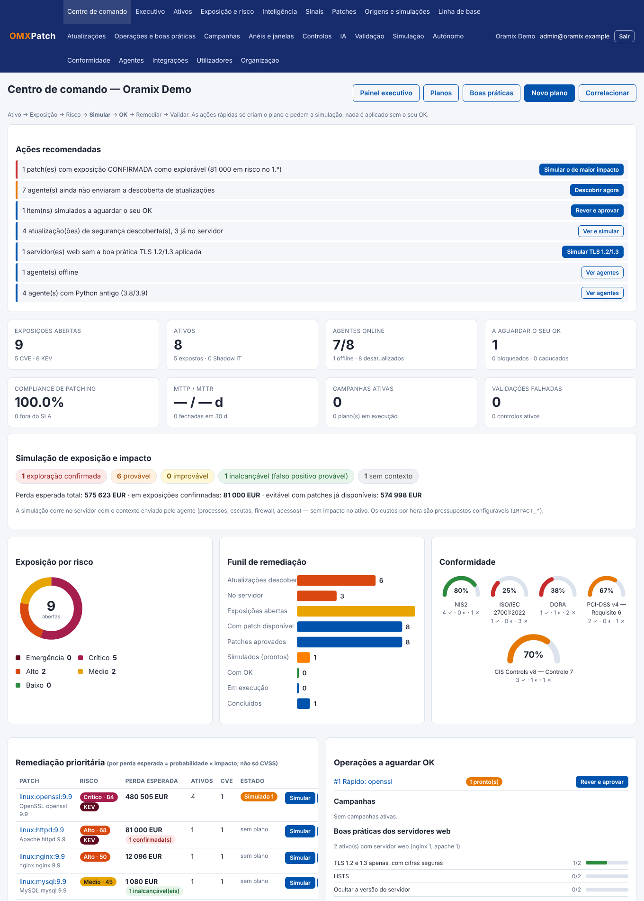

É a página inicial: o estado completo num só ecrã, com acesso rápido a **simular** e **remediar**.

- **Ações recomendadas:** a fila do que fazer primeiro, por prioridade. Cada linha tem o botão certo — por exemplo «Simular o mais urgente», «Rever e aprovar» ou «Descobrir agora».
- **Indicadores:** exposições abertas, ativos, agentes online, itens a aguardar o seu OK, compliance de patching, MTTP/MTTR, campanhas e validações falhadas.
- **Atualizações descobertas nos ativos:** quantas existem, quantas já estão no servidor e quantos agentes já enviaram a descoberta.
- **Simulação de exposição e impacto:** quantas exposições estão *confirmadas*, *prováveis*, *improváveis* ou *inalcançáveis*, e a **perda esperada** total (secção 6).
- **Exposição por risco, funil de remediação e conformidade** (NIS2, ISO 27001, DORA, PCI-DSS, CIS).
- **Remediação prioritária:** os patches ordenados por **perda esperada**, com os botões **Simular** e **Remediar…**.
- **Operações a aguardar OK, campanhas, boas práticas dos servidores web, frota, saúde das integrações e atividade recente.**

**Simular** cria um plano de operações e pede a simulação aos agentes; **Remediar…** faz o mesmo e leva-o ao plano para aprovar. **Nenhum dos dois instala nada.**

O menu **Executivo** mostra o painel de gestão (CISO): MTTP, MTTR, SLA e tendências de 12 semanas.

# 4. Ativos (CMDB)

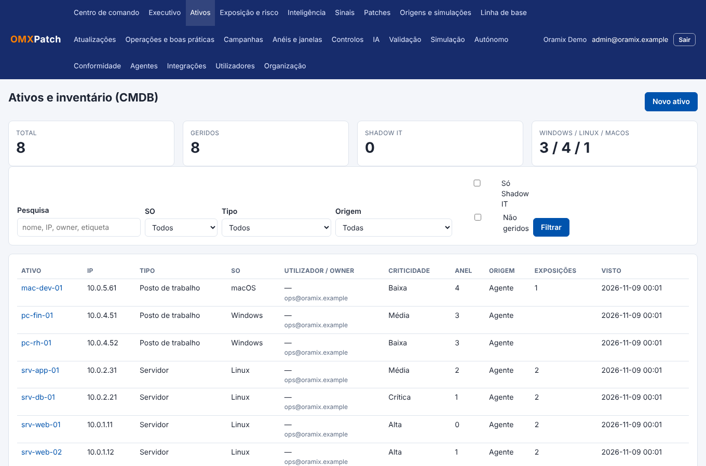

Em **Ativos** vê todos os equipamentos: servidores, postos de trabalho, VM cloud, contentores, IoT/OT, rede e serviços SaaS. Pode filtrar, importar (CSV) e executar **descoberta sem agente** por ligação TCP a portas de gestão (IoT/OT só se marcar a opção expressamente).

Cada ativo tem criticidade, valor de negócio (0–100), responsável, anel de teste, etiquetas e, se quiser, o **custo de indisponibilidade por hora** (usado na prioridade por impacto).

## 4.1 Detalhe do ativo e postura

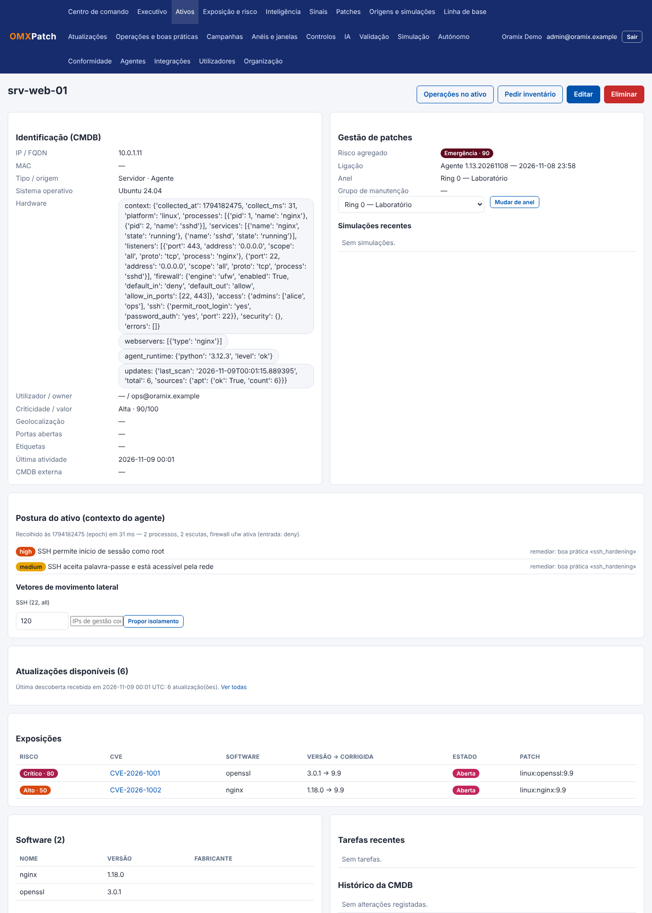

No detalhe do ativo encontra:

- identificação, hardware, anel e gestão de patches;
- **Postura do ativo:** com o contexto enviado pelo agente — processos, escutas de rede, firewall, administradores, SSH/RDP/SMB — a solução mostra as **configurações fracas** (SSH com root, SMBv1, RDP sem NLA, firewall desativada, base de dados aberta) com a ação recomendada, e os **vetores de movimento lateral** possíveis;
- **Atualizações disponíveis** e a data da última descoberta recebida;
- exposições, software instalado, tarefas recentes e histórico da CMDB;
- **Propor isolamento:** ver a secção 11.3.

Botões úteis: **Operações no ativo** (abre um plano para este ativo) e **Pedir inventário** (o agente envia o inventário no próximo contacto).

# 5. Exposição e risco

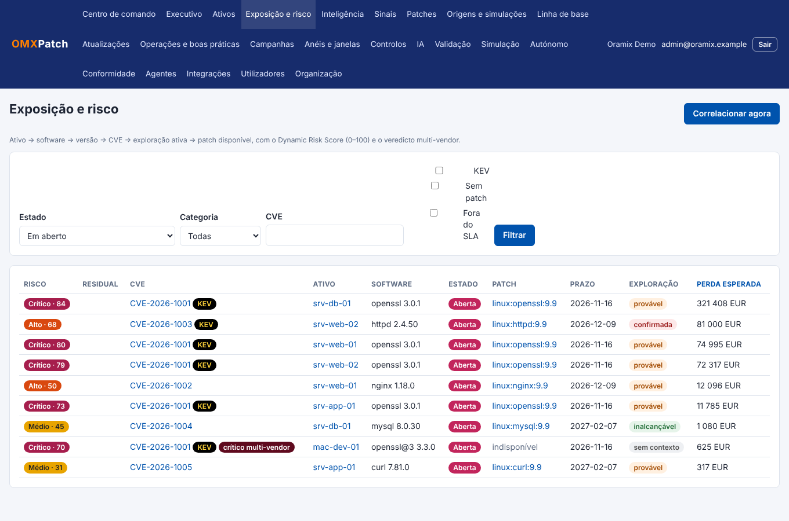

A lista de exposições mostra, para cada CVE em cada ativo: o **risco dinâmico** (0–100), o residual (depois de controlos), o software, o estado, o patch, o prazo (SLA), a **exploração** (resultado da simulação) e a **perda esperada**. Clique em **Perda esperada** para ordenar por impacto em vez de por CVSS.

## 5.1 Risco dinâmico

O risco (0–100) combina sete fatores, com os pesos: CVSS (25), EPSS (15), CISA KEV (15), criticidade do ativo (12), exposição à Internet (10), valor de negócio (8) e evidência de exploit (15). As categorias são **Baixo**, **Médio**, **Alto**, **Crítico** e **Emergência** (≥ 85). Os controlos compensatórios reduzem os pontos e dão o risco **residual**.

O **prazo** (SLA) depende da categoria: por omissão 1 dia para Emergência, 7 para Crítico, 30 para Alto, 90 para Médio e 180 para Baixo (o administrador pode alterar).

## 5.2 Detalhe da exposição

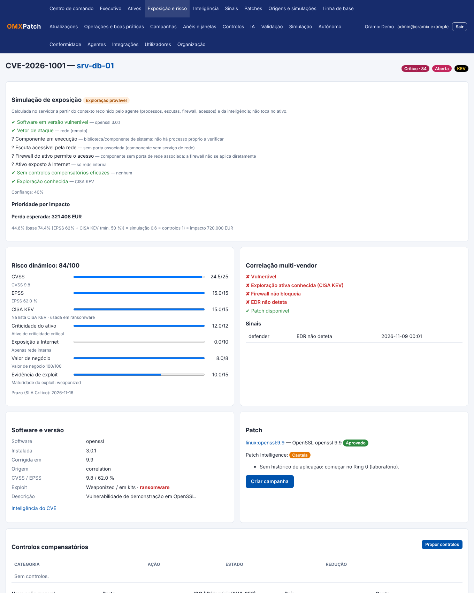

- **Simulação de exposição:** responde «isto pode mesmo ser explorado *aqui*?» (secção 6).
- **Risco dinâmico** com a decomposição por fator.
- **Correlação multi-vendor:** firewall, EDR e WAF de outras plataformas (sinais) e se o patch já existe.
- **Software e versão**, **patch** associado (com Patch Intelligence: histórico da comunidade e problemas conhecidos) e o botão **Criar campanha**.
- **Controlos compensatórios:** propostas de bloqueio de porta, deteções EDR, regras SIEM, virtual patch WAF, MFA, etc. para reduzir o risco enquanto não há patch.
- Validações (ciclo fechado) e simulações de ataque.

# 6. Simulação de exposição e prioridade por impacto

## 6.1 Como funciona

A simulação corre **no servidor**, sem qualquer impacto no ativo. Cruza a inteligência (KEV, maturidade do exploit, EPSS, vetor do CVSS) com o **contexto real** recolhido pelo agente e constrói o caminho de ataque em passos — cada um ✔ (ok), ✘ (falha) ou ? (desconhecido):

1. software em versão vulnerável;
2. vetor de ataque (rede, adjacente, local, físico);
3. o **componente está em execução**?
4. há uma **escuta acessível pela rede** (e não só em localhost)?
5. a **firewall do ativo** permite o acesso?
6. o ativo está exposto à Internet?
7. não há controlos compensatórios eficazes?
8. existe exploração conhecida?

O veredito é:

| Veredito | Significado |
|---|---|
| **Confirmada** | Componente a correr, alcançável e sem barreiras, com exploração conhecida. |
| **Provável** | Alcançável e sem barreiras (ou barreiras incompletas). |
| **Improvável** | Protegida por controlos, ou exige privilégios/acesso local não obtido. |
| **Inalcançável** | O contexto prova que não é alcançável (processo parado, escuta só em localhost, firewall a bloquear). Provável falso positivo. |
| **Sem contexto** | O agente ainda não enviou o contexto do ativo. |

As bibliotecas (por exemplo OpenSSL) não têm processo próprio: ficam «desconhecido» no passo 3 e **nunca** são dadas como inalcançáveis por esse motivo.

## 6.2 Perda esperada

Para decidir a ordem usa-se o **impacto**, não só o CVSS:

> **Perda esperada = P(exploração) × impacto do ativo**

- **P(exploração):** parte do EPSS (ou da maturidade do exploit/KEV), multiplicada pelo peso do veredito (confirmada 1,0 … inalcançável 0,03) e reduzida se houver controlos eficazes.
- **Impacto:** custo por hora do ativo (o seu valor próprio ou o da criticidade) × horas de paragem esperadas × fator de valor de negócio (0,5–1,5).

O detalhe da exposição mostra a conta completa. Os valores de custo/hora e as horas de paragem são **pressupostos configuráveis** pelo administrador — não são medições. Ajuste o custo por hora de cada ativo importante para resultados mais realistas.

# 7. Inteligência e sinais

- **Inteligência:** catálogo de CVE com CVSS, EPSS, CISA KEV, MITRE, notícias de exploração, avisos de fabricantes e famílias de malware. Pode consultar qualquer CVE.
- **Sinais:** eventos de outras plataformas (EDR, firewall, WAF, scanners) que alimentam a correlação multi-vendor. Podem entrar por API, ficheiro CSV ou conector.

# 8. Patches e atualizações

## 8.1 Atualizações disponíveis (descobertas pelos agentes)

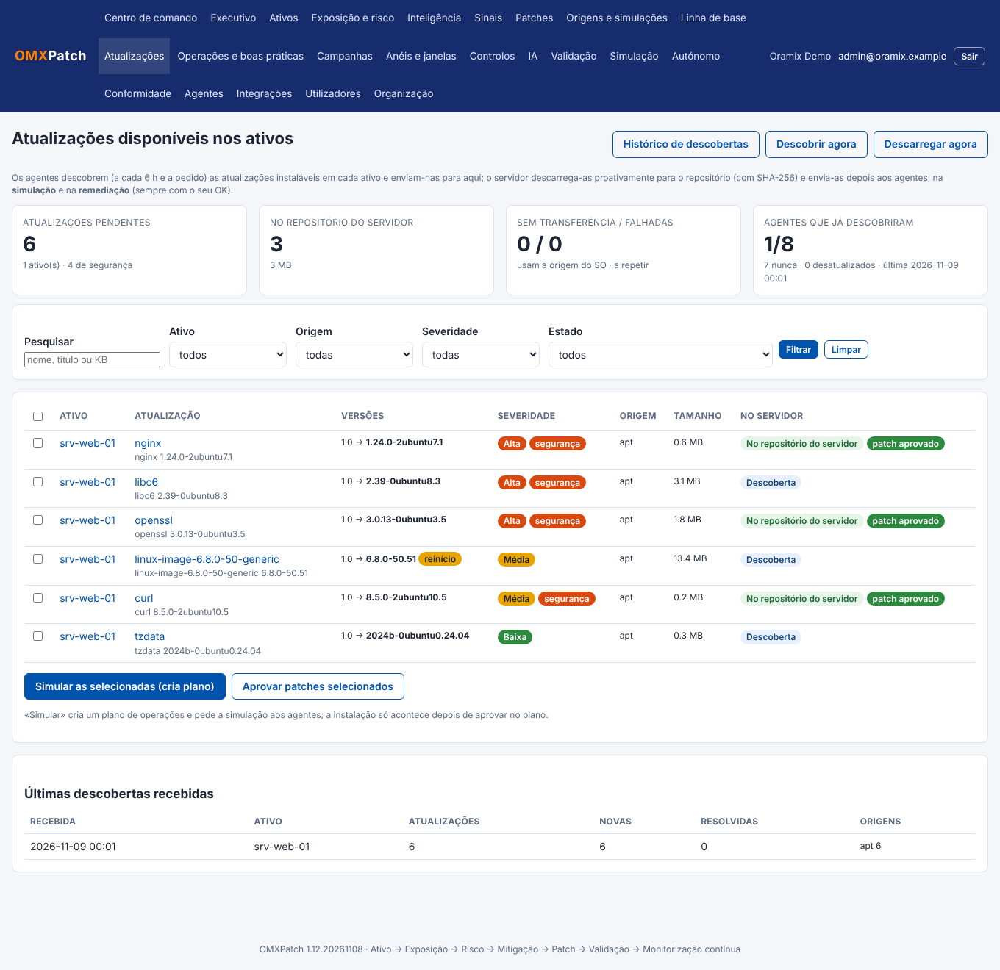

Em **Atualizações** vê **o que pode ser instalado** em cada ativo. Os agentes descobrem (a cada 6 horas e quando o pedir) as atualizações do sistema operativo e das aplicações — apt, dnf/yum, zypper, Windows Update/WSUS, winget, Chocolatey, softwareupdate e brew — **sem instalar nada**, e enviam-nas para o servidor. O servidor **confirma a receção**: cada descoberta fica no **Histórico de descobertas**.

O servidor **descarrega proativamente** para o seu repositório os ficheiros que têm endereço de origem e SHA-256 anunciado (por exemplo os pacotes `.deb` do apt e os MSI/EXE do winget); um ficheiro adulterado é rejeitado. Nos restantes casos (por exemplo Windows Update, dnf, macOS) a atualização usa o gestor ou serviço do próprio equipamento e aparece como «*usam a origem do SO*».

Estados:

| Estado | Significado |
|---|---|
| Descoberta | O agente reportou-a; ainda não foi transferida. |
| No repositório do servidor | O ficheiro já está no servidor (SHA-256 verificado). |
| Sem transferência | Não há origem verificável: usa o gestor do SO. |
| Transferência falhada | A repetir (com espera); veja o motivo no detalhe. |
| Instalada | Já não é listada pelo agente. |

**Botões:** *Descobrir agora* (pede a descoberta a todos os agentes), *Descarregar agora* (não espera pelo servidor), e, nas linhas selecionadas, **Simular as selecionadas (cria plano)** e **Aprovar patches selecionados**.

## 8.2 Patches (repositório)

O menu **Patches** é o repositório: cada patch tem origem, versão corrigida, CVE que resolve, ficheiro no servidor, estado (*Identificado*, *Em repositório*, *Aprovado*, *Rejeitado*, *Substituído*) e informação de inteligência (taxa de sucesso da comunidade, problemas conhecidos). Um patch tem de estar **Aprovado** para ser instalado.

**Origens e simulações** mostra as origens de atualização Windows (Windows Update, winget, Chocolatey, MSI, EXE, MSU, CAB, Office C2R) e quais os seus ativos podem usar.

# 9. Planos de operações — simular, dar OK, executar

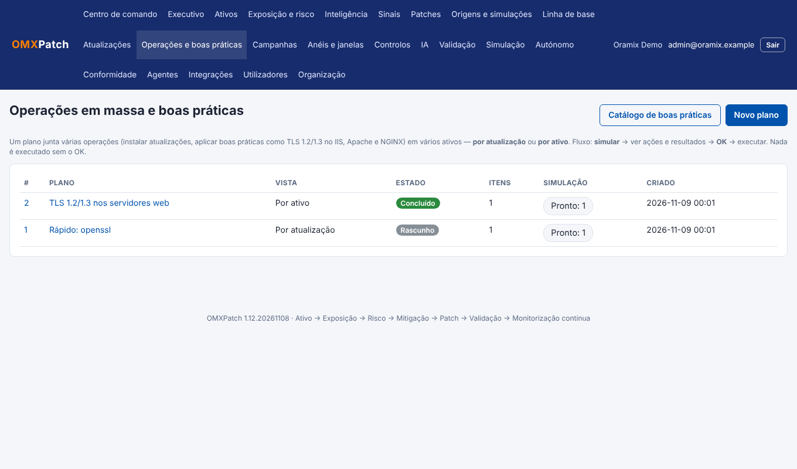

Os planos são o caminho principal para **instalar patches** e **aplicar boas práticas** em vários ativos, com total controlo.

## 9.1 Criar um plano

- A partir do **Centro de comando** («Simular» / «Remediar…»), das **Atualizações** («Simular as selecionadas») ou do detalhe de um patch/ativo («Operações em massa» / «Operações no ativo»).
- Em **Operações e boas práticas → Novo plano**: escolha o **modo** — *por atualização* (um patch/prática em vários ativos) ou *por ativo* (várias operações num ativo) — os ativos, os patches e as boas práticas, a política de reinício, a hora de início e se respeita as janelas de manutenção.

## 9.2 O ciclo

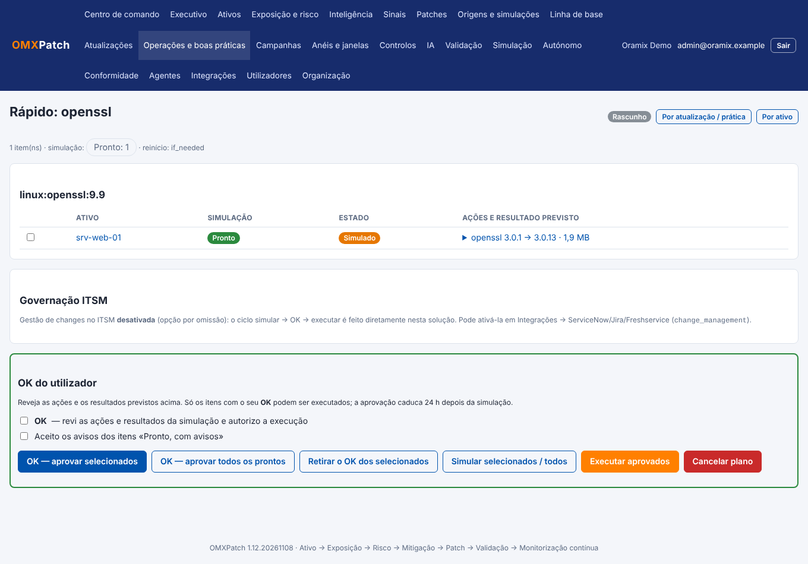

1. **Simular.** O agente **não altera nada** e devolve verificações, as **ações exatas** (com *diff* dos ficheiros) e o resultado previsto: **pronto**, **avisos**, **bloqueado**, **nada a fazer** ou **erro**.
2. **Rever e dar OK.** Reveja as ações. Marque a caixa **OK** e aprove. Só pode aprovar itens simulados há menos de 24 h e sem bloqueio; se houver avisos, tem de os aceitar expressamente. Pode ver o plano **por operação** ou **por ativo**.
3. **Executar.** Só os itens aprovados avançam, respeitando a hora de início e as janelas de manutenção. Cada item mostra o resultado e o que o agente fez.
4. **Reverter.** As boas práticas concluídas têm o botão **Reverter**.

> **Regra de ouro:** sem simulação e sem OK, não há instalação. Uma simulação com mais de 24 h caduca e tem de ser repetida.

Se a sua organização usa **gestão de changes no ITSM**, o plano mostra o painel **Governação ITSM**: peça a change, aguarde a aprovação e só então execute (ver o *Manual de Administração*, secção 6.4). Por omissão esta funcionalidade está **desativada**: o ciclo simular → OK → executar é feito inteiramente aqui.

# 10. Boas práticas


Além de patches, a solução aplica **boas práticas de configuração**, sempre com simulação e OK, com cópia de segurança, teste, verificação e **reversão automática** se algo falhar:

| Boa prática | Aplica-se a |
|---|---|
| **TLS 1.2 e 1.3 apenas**, com cifras seguras | nginx, Apache, IIS (no IIS exige reinício) |
| **HSTS** | nginx, Apache, IIS |
| **Ocultar a versão do servidor** | nginx, Apache, IIS |
| **Cabeçalhos de segurança** | nginx, Apache, IIS |
| **SSH sem root e sem palavras-passe vazias** | Linux e macOS |
| **Desativar SMBv1 e exigir NLA no RDP** | Windows |

No **SSH**, a palavra-passe só se desativa se existir pelo menos uma chave autorizada (para não ficar sem acesso). Cada boa prática diz o seu **risco** e o que pode afetar (por exemplo clientes antigos que deixam de ligar com TLS 1.2).

# 11. Controlos, isolamento e remediação direcionada

## 11.1 Controlos compensatórios

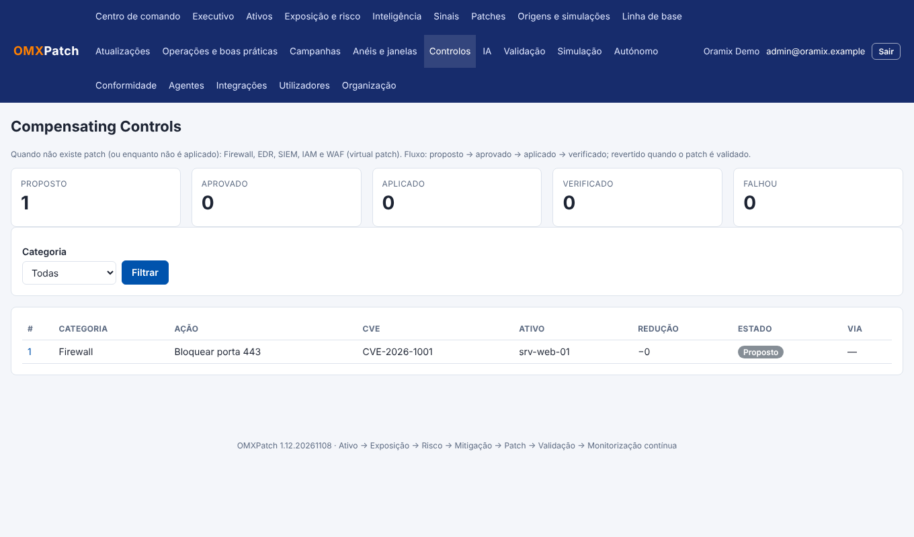

Quando ainda não há patch, **proponha controlos** na exposição: bloqueio de porta ou de IOC, deteções/bloqueios EDR, regras SIEM, virtual patch WAF, forçar MFA… Cada controlo fica **Proposto**, depois **Aprovado**, **Aplicado** e **Verificado**, com o artefacto gerado (por exemplo as regras de firewall). Os controlos de firewall local são aplicados pelo agente; os outros pelos conectores (ou manualmente). A porta de gestão (SSH, RDP, WinRM, SMB) tem salvaguardas.

## 11.2 Remediação direcionada

A **Remediação prioritária** do Centro de comando ordena por **perda esperada**, mostra quantas exposições estão *confirmadas* e qual o estado do plano de cada patch. Comece pelo topo: é onde a correção reduz mais risco financeiro.

## 11.3 Isolar um ativo

No detalhe do ativo (com agente), **Propor isolamento** cria um controlo **proposto** que tem de ser **aprovado** e **aplicado**. O agente corta o tráfego do ativo **mantendo só a ligação à consola** (e, se indicar, o SSH de IP de gestão). Salvaguardas: o agente testa a consola depois de isolar e **desfaz sozinho** se a perder; o isolamento tem validade (por omissão 2 h, máximo 24 h) e liberta-se sozinho; o estado anterior da firewall é reposto. Para libertar antes do prazo use **Libertar isolamento** no controlo.

# 12. Campanhas, anéis e janelas

- **Anéis e janelas:** defina o anel de cada ativo (0–4) e as **janelas de manutenção** em que se pode instalar. Cada anel tem critérios de promoção (sucesso mínimo, crashes máximos, pontuação de experiência, tempo de observação).
- **Campanhas:** distribuem um patch aprovado por anéis, com política de reinício, limite de largura de banda e **exigência de simulação prévia** por ativo. Só passa ao anel seguinte se o anterior cumprir os critérios. As campanhas podem ser colocadas em pausa ou canceladas.
- **Wake-on-LAN:** os ativos desligados podem ser acordados na janela.

# 13. Linha de base (gold images)

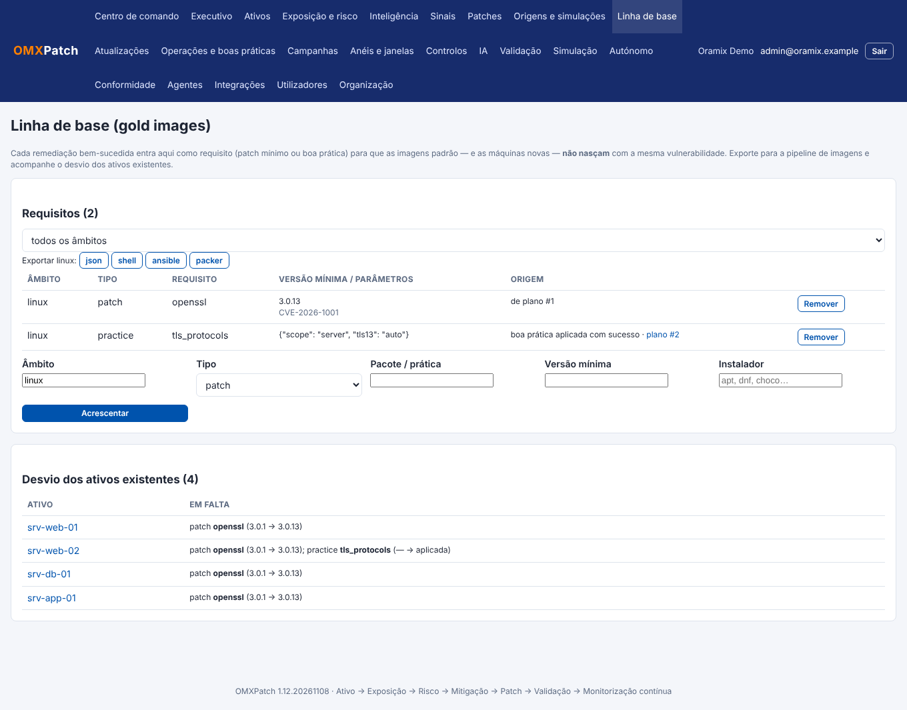

Cada remediação **bem-sucedida** passa para a **linha de base** do seu sistema operativo (patch → versão mínima; boa prática → parâmetros), para que as **imagens padrão e as máquinas novas não nasçam com a mesma vulnerabilidade**.

- **Requisitos:** pode acrescentar ou remover manualmente.
- **Desvio:** lista os ativos existentes que não cumprem a linha de base (versão abaixo da mínima ou boa prática por aplicar).
- **Exportar** para **Ansible**, **shell** (com verificação das versões mínimas: falha o *build* se a imagem ficar abaixo), **Packer** ou **JSON**, para a sua pipeline de imagens.

# 14. Validação, simulação de ataque e fluxos autónomos

- **Validação (ciclo fechado):** depois de corrigir, a solução verifica se o patch ficou instalado e se a vulnerabilidade desapareceu; só então fecha a exposição. Falhas aparecem na lista de validações.
- **Simulação (BAS):** testa, de forma segura e não destrutiva, cenários de ransomware, movimento lateral, roubo de credenciais e cadeia de exploração, e diz se os seus controlos teriam bloqueado ou detetado.
- **Autónomo:** o administrador pode ligar fluxos que percorrem descoberta, avaliação, patch, anéis, validação e fecho — em modo **Aconselhar** (propõe e um humano aprova) ou **Autónomo** (até ao Ring 4, com validação).
- **IA:** pergunte em linguagem natural (por exemplo «Como reduzir o risco do ativo X para menos de 20 pontos?»). A IA só interpreta e explica; o plano e os números vêm do motor determinístico.

# 15. Conformidade e relatórios

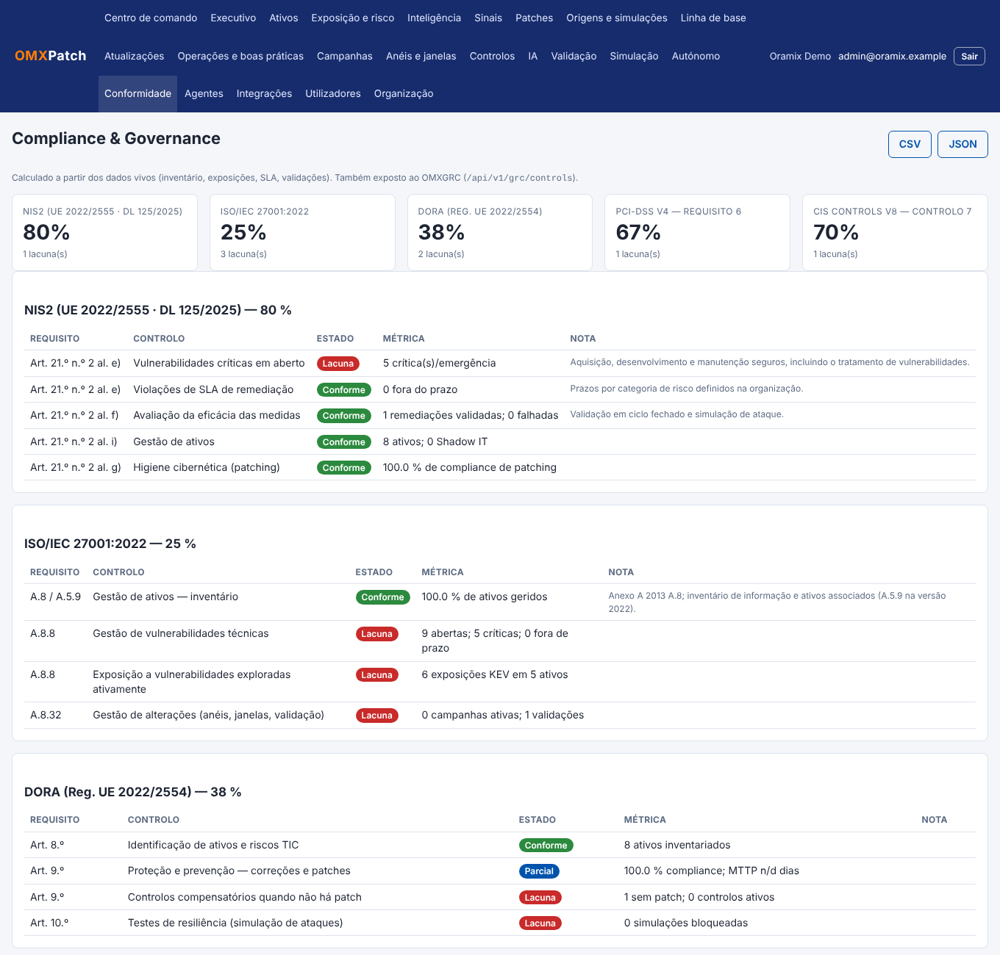

**Conformidade** mapeia o estado do patching para os requisitos de **NIS2**, **ISO/IEC 27001**, **DORA**, **PCI-DSS** e **CIS Controls**, com a métrica e o estado de cada um (*conforme*, *parcial*, *lacuna*). Pode exportar em **CSV** e **JSON** para o seu GRC (o OMXGRC consome isto automaticamente).

# 16. Automatizar com a API

No seu perfil crie um **token de API**. Use-o no cabeçalho `Authorization: Bearer omp_…`. Alguns exemplos:

```bash
# Exposições por perda esperada
curl -H "Authorization: Bearer $T" https://omxpatch:4434/api/v1/priority
# Atualizações pendentes e descobrir agora
curl -H "Authorization: Bearer $T" https://omxpatch:4434/api/v1/updates?severity=high
curl -X POST -H "Authorization: Bearer $T" https://omxpatch:4434/api/v1/updates/scan
# Plano: criar, simular, aprovar (exige "ok": true) e executar
curl -X POST -H "Authorization: Bearer $T" -H "Content-Type: application/json" \
     -d '{"name":"TLS","mode":"by_asset","asset_ids":[1],"practices":[{"id":"tls_protocols"}]}' \
     https://omxpatch:4434/api/v1/plans
```

A lista completa está na *Referência técnica* (`REFERENCIA.md`). A API respeita o seu perfil e a sua organização.

# 17. Boas práticas de utilização

1. **Comece pelo topo** das *Ações recomendadas* e da *Remediação prioritária*.
2. **Mantenha o contexto fresco:** agentes online e a descoberta a chegar (veja o Histórico de descobertas). Sem contexto a simulação fica «sem contexto» e a prioridade é menos fiável.
3. **Preencha o valor do ativo** (criticidade, valor de negócio e custo por hora) nos ativos importantes.
4. **Teste primeiro nos anéis baixos** (0 e 1) e use as janelas de manutenção.
5. **Leia os avisos da simulação** antes de dar OK, sobretudo reinícios e clientes antigos.
6. **Valide sempre**: uma exposição só fecha com a validação a passar.
7. **Alimente a linha de base** para parar de repetir o mesmo trabalho em cada imagem nova.

# 18. Problemas frequentes

| Situação | O que fazer |
|---|---|
| Não vejo botões de ação | O seu perfil é **Auditor** (só leitura) ou não tem permissão. Peça a um administrador. |
| «Sem contexto» em todas as exposições | O agente ainda não enviou o contexto: espere um inventário (até 24 h) ou use **Pedir inventário** no ativo. |
| A simulação ficou «bloqueada» | Leia o motivo no plano: ativo sem agente, origem de atualização indisponível, patch para outro SO, ou pré-requisito em falta. |
| «A simulação tem mais de 24 h» | Simule de novo; só depois pode aprovar. |
| Atualização em «Sem transferência» | Normal para Windows Update, dnf e macOS: instala pelo gestor do SO; a simulação mostra o resultado. |
| Atualização em «Transferência falhada» | Veja o detalhe (hash não confere, tamanho acima do limite, endereço bloqueado). O servidor repete com espera. |
| Plano bloqueado pelo ITSM | A gestão de changes está ativa: peça a change e aguarde a aprovação no ITSM. |
| Agente offline | Verifique rede/serviço no ativo; a consola mostra o último contacto em **Agentes** (administrador). |
| Não consigo entrar | Após várias falhas a conta bloqueia temporariamente; peça a um administrador para repor o acesso/MFA. |

# 19. Glossário

- **CVE:** identificador público de uma vulnerabilidade.
- **CVSS:** gravidade teórica de 0 a 10.
- **EPSS:** probabilidade (0–1) de uma CVE ser explorada nos próximos 30 dias.
- **CISA KEV:** lista de vulnerabilidades já exploradas ativamente.
- **Exposição:** uma CVE num ativo concreto.
- **Perda esperada:** probabilidade de exploração × impacto no negócio.
- **Plano de operações:** conjunto de patches/boas práticas em ativos, com simulação e OK.
- **Anel (ring):** grupo de ativos para implementação faseada (0 laboratório … 4 produção).
- **Linha de base (gold image):** requisitos mínimos que as imagens padrão devem trazer.
- **Isolamento:** corte do tráfego de um ativo mantendo só a consola.
- **Thumbprint / impressão digital:** identificador do certificado do servidor em que os agentes confiam.


# Anexo — Operar e acompanhar um agente
Em **Agentes**, o botão **Detalhe** mostra o estado de cada agente (online/offline, versão, depuração) e os seus registos de operação, auditoria e depuração, com filtros e exportação CSV. O administrador pode ainda reiniciar ou atualizar o agente, e ativar a depuração completa por um tempo limitado. Os comandos são aplicados no contacto seguinte do agente (de 5 em 5 minutos). Um agente que fique 2 horas sem conseguir falar com a consola desliga-se sozinho; veja no Manual de Administração como o reativar.
